# Ручное E2E-тестирование фронтенда — 17.10.2026

Окружение: `pnpm dev` (http://localhost:3000) + mock-сервер (http://localhost:8080), браузерная панель Claude: скриншоты на ширине 716 px, десктопная раскладка (1440 px) проверялась через DOM, мобильная — 375×812.
Данные: чистые сиды mock (перезапуск перед прогоном). Демо-аккаунты: волонтёр **Мария Иванова**, координатор **Ирина Ковалёва**.

Легенда вердиктов: ✅ пройден · ❌ баг · ⚠️ замечание (работает, но есть проблема UX/текста)

## Итог

**22 теста · 5 багов найдено и исправлено · 15 замечаний**

| Тест | Вердикт | Тест | Вердикт |
|---|---|---|---|
| T01 Лендинг | ❌→✅ БАГ-1 | T12 Принятие и отклонение заявок | ✅ |
| T02 Защита кабинета | ✅ | T13 Чат (координатор) | ✅ |
| T03 Демо-вход волонтёра | ✅ | T14 Подведение итогов | ✅ |
| T04 Профиль волонтёра | ✅ | T15 Выдача заказов | ❌→✅ БАГ-3 |
| T05 Каталог | ✅ | T16 Создание мероприятия | ✅ |
| T06 Цикл заявки | ✅ | T17 Профиль волонтёра у координатора | ✅ |
| T07 Обмен койнов | ✅ | T18 Создание приглашения, QR | ✅ |
| T08 Профиль координатора у волонтёра | ✅ | T19 Загрузка фото | ❌→✅ БАГ-4 |
| T09 Доступ волонтёра к страницам координатора | ✅ | T20 Сквозная проверка у волонтёра | ❌→✅ БАГ-5 |
| T10 Выход, демо-вход координатора | ❌→✅ БАГ-2 | T21 Мобильная вёрстка | ✅ |
| T11 Счётчики координатора | ✅ | T22 Выход из команды и вступление по ссылке | ✅ |

### Найденные баги (все исправлены и перепроверены)

| № | Баг | Где исправлено |
|---|---|---|
| БАГ-1 | Мобильное меню лендинга: якорь проскакивает секцию на высоту меню | `assets/scss/_landing.scss` — меню выпадает поверх страницы, не сдвигая контент |
| БАГ-2 | Демо-вход координатора открывал кабинет волонтёра | `composables/auth/useAuth.ts` — переход сразу на домашнюю страницу роли |
| БАГ-3 | Выданный или отменённый заказ остаётся под фильтром «Ожидает выдачи»; то же для заявок с фильтром | `core/reward-order/stores/reward-orders.store.ts`, `core/participation/stores/participations.store.ts` |
| БАГ-4 | Битый файл (тип PNG, внутри мусор) открывал пустое зависшее окно кадрирования | `components/app/ImageCropDialog.vue` — ошибка загрузки картинки даёт тост и закрывает окно |
| БАГ-5 | «Ближайшие мероприятия» не обновлялись после отмены заявки | `pages/cabinet/index.vue` — перезагрузка при изменении статусов заявок |

### Исправленные замечания

- ЗАМЕЧАНИЕ-1: единое написание валюты — «койн / койны / койнов» во всём кабинете (как на лендинге и в описании кейса).
- ЗАМЕЧАНИЕ-2: «Ближайшие дела» → «Ближайшие мероприятия», «…мероприятие появится здесь».

### Замечания на ваше решение (не исправлял)

3 — нет метки «Прошло» у прошедших незавершённых мероприятий в каталоге; 4 — диалоги подтверждения в стиле старого шаблона; 5 — «Ещё 10» → «Не хватает 10 койнов»; 6 — статус «Сотрудничество» → «В команде»; 7 — в окне отклонения не сказано, что отказ окончательный; 8 — сообщения чата прижаты к верху; 9 — «Выдано» без подтверждения; 10 — начало мероприятия по умолчанию 04:00 ночи; 11 — счётчик часов отбрасывает минуты (8 вместо 8,5); 12 — какое фото показывать в шапке в режиме координатора; 13 — пустой список под фильтром выглядит как «заявок нет вообще»; 14 — нет предпросмотра приглашения (ограничение proto); 15 — вкладки на телефоне прокручиваются без подсказки.

### Чего этот прогон не покрывает

Вход через настоящий Флида ID; работа с реальным бэкендом (на нём пока только сессии и загрузка картинок); стрим чата у двух одновременных пользователей (проверял последовательно одной сессией браузера); адрес через Яндекс-геокодер (нет ключа — работает запасной OSM).

---

## План

| № | Тест | Роль |
|---|---|---|
| T01 | Лендинг: загрузка, якоря меню, город, CTA | гость |
| T02 | Защита кабинета: гость → редирект на вход | гость |
| T03 | Демо-вход волонтёра | гость → волонтёр |
| T04 | Профиль волонтёра: данные и счётчики | волонтёр |
| T05 | Каталог мероприятий и фильтры | волонтёр |
| T06 | Подача, отмена и повторная подача заявки | волонтёр |
| T07 | Поощрения: обмен коинов, недостаток баланса | волонтёр |
| T08 | Профиль координатора глазами волонтёра | волонтёр |
| T09 | Доступ волонтёра к страницам координатора | волонтёр |
| T10 | Выход и демо-вход координатора | координатор |
| T11 | Кабинет координатора: счётчики «Нужно внимание» | координатор |
| T12 | Принятие и отклонение заявок | координатор |
| T13 | Чат мероприятия | координатор ↔ волонтёр |
| T14 | Подведение итогов, начисление коинов | координатор |
| T15 | Заказы поощрений: выдача | координатор |
| T16 | Создание мероприятия: валидация и успех | координатор |
| T17 | Профиль волонтёра глазами координатора | координатор |
| T18 | Приглашение в команду по ссылке | координатор → волонтёр |
| T19 | Загрузка фото: неверный файл, кадрирование | обе |
| T20 | Сквозная проверка: результаты у волонтёра после действий координатора | волонтёр |
| T21 | Мобильная вёрстка ключевых страниц | обе |
| T22 | Выход из команды и вступление по ссылке | волонтёр |

---

## T01 — Лендинг ❌ (1 баг, 1 замечание)

| Шаг | Действие | Что увидел |
|---|---|---|
| 1 | Открыл `/` гостем (ширина 716 px) | Шапка: логотип, «Обнинск», «Войти», «Стать волонтёром», бургер. Hero «Цифровой волонтёр Обнинска». Горизонтального скролла нет. 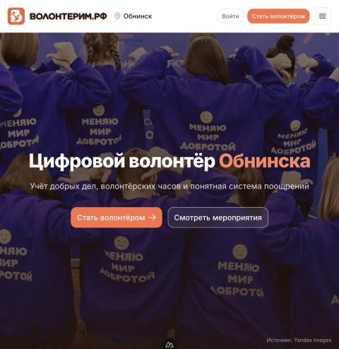 |
| 2 | DOM-проверка | Пункты меню: О проекте / Как это работает / Мероприятия / Для кого / Вопросы; секции `about, steps, events, audience, faq` существуют |
| 3 | Клик по бургеру | Открылось меню с 5 пунктами и «Войти» 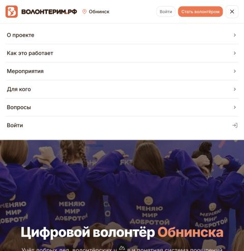 |
| 4 | Клик «Мероприятия» в мобильном меню | Меню закрылось, но **страница проскочила секцию**: верх `#events` = −258 px, на экране уже «Добро для всех» 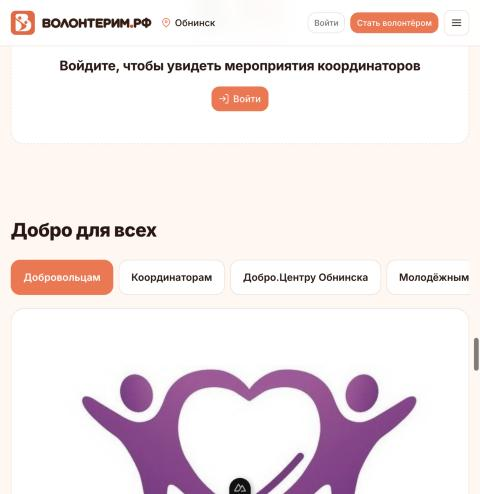 |
| 5 | Тот же якорь на десктопе (1440 px, меню нет) | `#events` встал на 84 px (шапка 68 + отступ 16) — корректно |
| 6 | Клик «Обнинск» | Диалог «Город или регион», Яндекс-карта загрузилась, у гостя кнопка «Применить» без счётчика 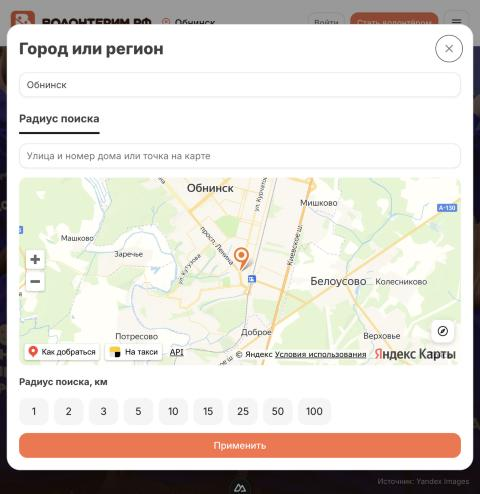 |
| 7 | Клик «Стать волонтёром» | Переход на `/auth/login` |

**Вердикт:** ❌ **БАГ-1**: в мобильном меню якорные ссылки проскакивают секцию на высоту меню. Причина: меню внутри sticky-шапки занимает место в потоке; `scrollIntoView` считается при открытом меню, после закрытия контент сдвигается вверх.
⚠️ **ЗАМЕЧАНИЕ-1**: на лендинге «койны», в кабинете «коины» — разное написание валюты.

## T02 — Защита кабинета для гостя ✅

| Шаг | Действие | Что увидел |
|---|---|---|
| 1 | Гостем открыл `/cabinet/coordinator/events` | Редирект на `/auth/login`, cookie `redirectAfterLogin=/cabinet/coordinator/events` сохранена 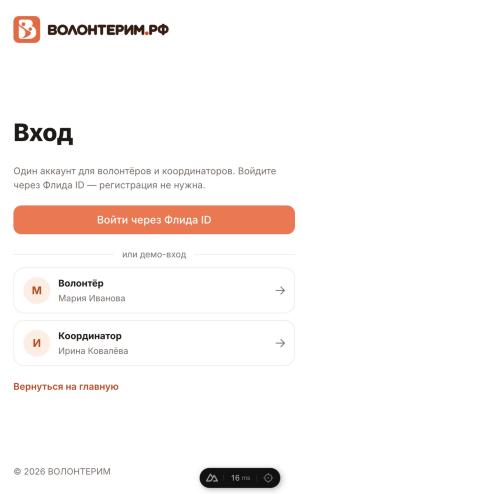 |
| 2 | Страница входа | «Войти через Флида ID», блок «или демо-вход» (Волонтёр — Мария Иванова, Координатор — Ирина Ковалёва), «Вернуться на главную» |

**Вердикт:** ✅ гостя не пускает в кабинет, адрес для возврата запоминается.

## T03 — Демо-вход волонтёра ✅

| Шаг | Действие | Что увидел |
|---|---|---|
| 1 | На `/auth/login` клик «Волонтёр — Мария Иванова» | Переход на `/cabinet` (сохранённый адрес координаторской страницы для демо-входа сброшен, `/access` не открывается) 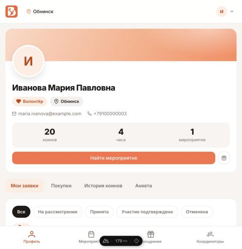 |
| 2 | Шапка | Аватар-буква «И», город «Обнинск», нижняя навигация: Профиль / Мероприятия / Поощрения / Координаторы |

**Вердикт:** ✅

## T04 — Профиль волонтёра: данные и счётчики ✅ (1 замечание)

Ожидание по сидам: +40 койнов за 4 ч («Высадка деревьев»), −20 за значок → баланс 20, 4 часа, 1 мероприятие.

| Шаг | Действие | Что увидел |
|---|---|---|
| 1 | Шапка профиля | Иванова Мария Павловна, чипы «Волонтёр», «Обнинск», почта, телефон; **20 коинов · 4 часа · 1 мероприятие** — совпадает |
| 2 | Вкладка «Мои заявки» | «Высадка деревьев…» — Участие подтверждено, +40 за 4 ч; «Помощь приюту…» — Принята; «Субботник…» — Принята + кнопка «Отменить» |
| 3 | Боковая колонка | «Ближайшие дела»: Субботник 20.10; «Мои координаторы»: Орлов Н. А., Ковалёва И. С. |
| 4 | Вкладка «Покупки» | Значок «Волонтёр Обнинска», 20 коинов, Ковалёва И. С., 7.10, Выдано |
| 5 | Вкладка «История коинов» | −20 (баланс 20), +40 и +4 ч (баланс 40) 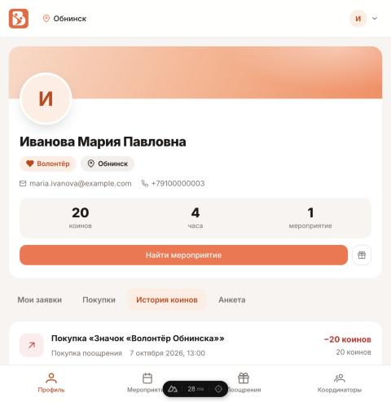 |

**Вердикт:** ✅ данные согласованы между счётчиками, заявками, покупками и историей.
⚠️ **ЗАМЕЧАНИЕ-2**: в боковой колонке остались «Ближайшие **дела**» и «…**дело** появится здесь» — по вашему требованию должно быть «мероприятия».

## T05 — Каталог мероприятий ✅ (1 замечание)

| Шаг | Действие | Что увидел |
|---|---|---|
| 1 | Открыл «Мероприятия» | Заголовок «Мероприятия в Обнинске», фильтр «Предстоящие», 5 карточек по дате: Субботник (+30), Турнир (+30), Экоакция (+40), Школа наставников (+20), Зимний праздник (+20) 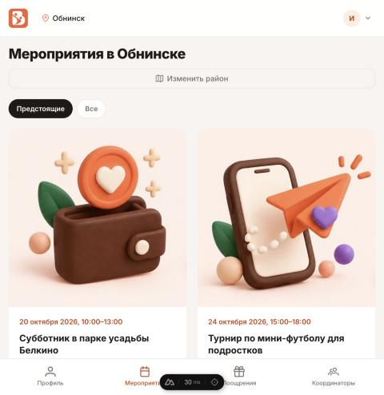 |
| 2 | Проверил расчёт койнов | 3 ч → 30, 4 ч → 40, 2 ч → 20 — верно (1 ч = 10) |
| 3 | Фильтр «Все» | +2 прошедших: «Высадка деревьев» с меткой «Завершено» и «Помощь приюту» (16.10) — **без метки** |

**Вердикт:** ✅ список и фильтр работают.
⚠️ **ЗАМЕЧАНИЕ-3**: прошедшее, но ещё не завершённое координатором мероприятие («Помощь приюту», 16.10) в каталоге выглядит как предстоящее — нет метки «Прошло».

## T06 — Подача, отмена, повторная подача заявки ✅ (1 замечание)

| Шаг | Действие | Что увидел |
|---|---|---|
| 1 | Открыл «Экоакция «Раздельный сбор»» | Слева иллюстрация, «Участвуют 0 из 12», «Подать заявку»; справа +40, Когда / Организатор (ссылка) / Засчитаем 4 ч, блок «Место проведения» с картой, «О мероприятии» 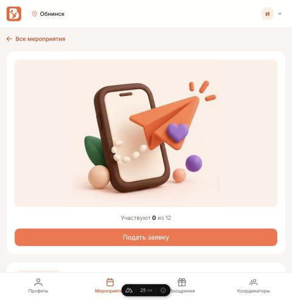 |
| 2 | Клик «Подать заявку» | Тост «Заявка отправлена координатору», статус «На рассмотрении», кнопки «Отменить заявку», «История заявки» 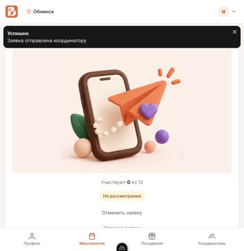 |
| 3 | Клик «Отменить заявку» | Подтверждение «Отмена заявки — Отменить заявку на мероприятие?» 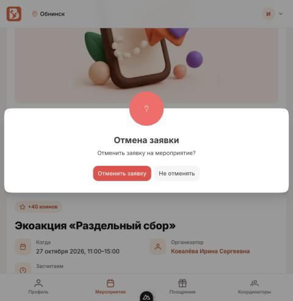 |
| 4 | Подтвердил | Тост «Заявка отменена», статус «Отменена», кнопка «Подать заявку снова» |
| 5 | Клик «Подать заявку снова» | Тост «Заявка снова на рассмотрении», статус «На рассмотрении» |
| 6 | «История заявки» | На рассмотрении → Отменена («Отменена волонтёром») → На рассмотрении, с временем 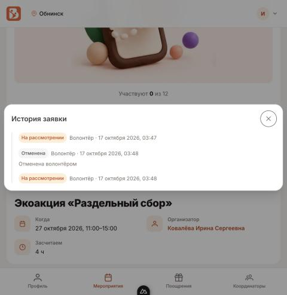 |

**Вердикт:** ✅ весь жизненный цикл заявки со стороны волонтёра работает. Заявка оставлена «На рассмотрении» для T12.
⚠️ **ЗАМЕЧАНИЕ-4**: диалоги подтверждения (красный круг с «?») — из старого шаблона, не в стиле нового дизайна.

## T07 — Поощрения: обмен койнов ✅ (1 замечание)

| Шаг | Действие | Что увидел |
|---|---|---|
| 1 | Открыл «Поощрения», баланс 20 | Билет на мастер-класс 30 — «Ещё 10» (неактивна), Благодарственное письмо 40 — «Ещё 20» (неактивна), Значок 20 — «Обменять», Шоппер 60 — «Ещё 40» (неактивна) 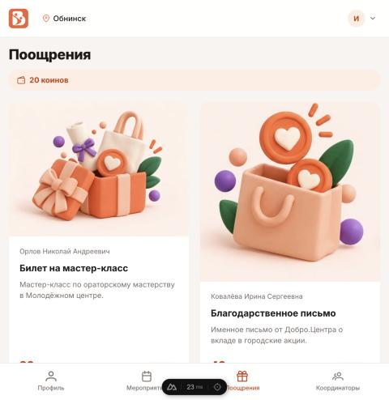 |
| 2 | Клик «Обменять» у значка | Подтверждение «Обмен коинов — Обменять 20 коинов на «Значок…»?» 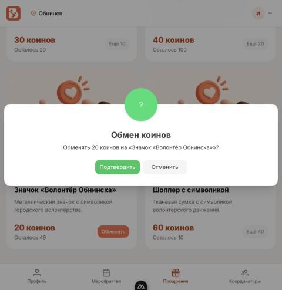 |
| 3 | «Подтвердить» | Тост «Запрос на поощрение оформлен», баланс **20 → 0**, «Осталось 49 → 48», кнопка у значка стала «Ещё 20» |
| 4 | Профиль → «Покупки» | Новый заказ «Ожидает выдачи» с кнопкой «Отменить» + старый «Выдано»; счётчик 0 коинов |

**Вердикт:** ✅ списание, остаток и блокировка при нехватке работают. Заказ оставлен для T15.
⚠️ **ЗАМЕЧАНИЕ-5**: подпись «Ещё 10» на неактивной кнопке непонятна — лучше «Не хватает 10 койнов».

## T08 — Профиль координатора глазами волонтёра ✅ (1 замечание)

| Шаг | Действие | Что увидел |
|---|---|---|
| 1 | «Координаторы» | Ковалёва И. С. и Орлов Н. А., у обоих статус «Сотрудничество», кнопки «Профиль», «Покинуть команду» 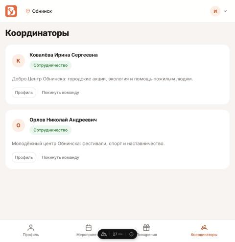 |
| 2 | Профиль Орлова | Фиолетовая обложка, описание, **2 мероприятия · 1 поощрение**, «Покинуть команду» 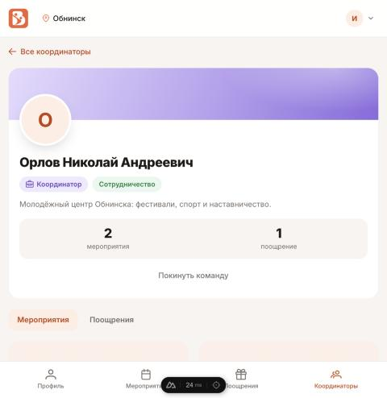 |
| 3 | Вкладка «Мероприятия» | Турнир по мини-футболу (24.10, +30), Школа наставников (1.11, +20) |
| 4 | Вкладка «Поощрения» | Билет на мастер-класс, 30, «Ещё 30» (баланс 0) |

**Вердикт:** ✅
⚠️ **ЗАМЕЧАНИЕ-6**: статус активного сотрудничества подписан «Сотрудничество» — неинформативно, лучше «В команде».

## T09 — Доступ волонтёра к страницам координатора ✅

| Шаг | Действие | Что увидел |
|---|---|---|
| 1 | Мария открывает `/cabinet/coordinator` | Редирект на `/access`: «403 Доступ запрещен» и ссылка «В кабинет» 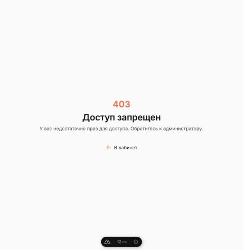 |
| 2 | Меню под аватаром | Иванова Мария Павловна / Мой профиль / Анкета / Выйти — пункта смены режима нет (у Марии нет профиля координатора) 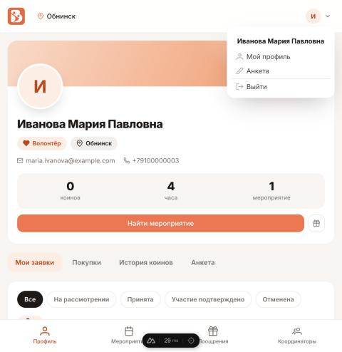 |

**Вердикт:** ✅

## T10 — Выход и демо-вход координатора ❌ → исправлено ✅

| Шаг | Действие | Что увидел |
|---|---|---|
| 1 | Меню аватара → «Выйти» | Переход на `/auth/login`; повторный заход на `/cabinet` снова требует входа — выход работает |
| 2 | Клик «Координатор — Ирина Ковалёва» | **Открылся кабинет волонтёра `/cabinet`**, а не координатора 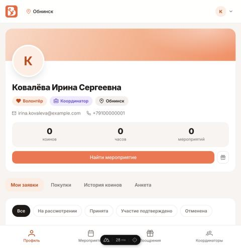 |
| 3 | Диагностика: перехватил `history.replaceState` | Единственный переход — `replace /cabinet`, в localStorage `cabinetMode=volunteer` |
| 4 | Причина | `useLocalStorage` (VueUse) пишет в localStorage отложенно; демо-вход ставит режим «координатор» в одном экземпляре, а `redirectAfterLogin` сразу читает старое «volunteer» через другой |
| 5 | Исправление | Демо-вход сразу ведёт на домашнюю страницу роли (`homeFor(account.mode)`), режим выставляет middleware по адресу |
| 6 | Повтор: выход → «Координатор» | `/cabinet/coordinator`, `cabinetMode=coordinator`, меню: Профиль / Мероприятия / Волонтёры / Заказы 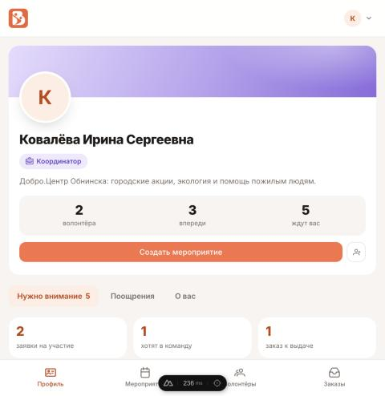 |

**Вердикт:** ❌ **БАГ-2** (демо-вход координатора открывал кабинет волонтёра) — **исправлен и перепроверен** ✅.

## T11 — Кабинет координатора: счётчики ✅

Ожидание: заявки на участие — Дмитрий (Субботник) + Мария (Экоакция, из T06) = 2; в команду — Екатерина = 1; к выдаче — значок Марии (T07) = 1; ждут итогов — «Помощь приюту» = 1. Итого 5.

| Шаг | Что увидел |
|---|---|
| Шапка | Ковалёва И. С., «Координатор», описание; **2 волонтёра · 3 впереди · 5 ждут вас**, «Создать мероприятие» |
| Вкладка «Нужно внимание 5» | Плитки: 2 заявки на участие · 1 хотят в команду · 1 заказ к выдаче; «Подведите итоги: Помощь приюту (2 участника)»; ближайшие: Субботник (1 из 20, 1 новая заявка), Экоакция (0 из 12, 1 новая заявка), Зимний праздник (0 из 15) |

**Вердикт:** ✅ все числа совпадают с ожиданием.

## T12 — Принятие и отклонение заявок ✅ (1 замечание)

| Шаг | Действие | Что увидел |
|---|---|---|
| 1 | Экоакция (кабинет координатора) | Вкладки «Заявки волонтёров 1 / Чат», фильтр «Новые 1 / Участники 0 / Остальные»; Иванова М. П. — «На рассмотрении», телефон, почта, «Отклонить / Принять / История» 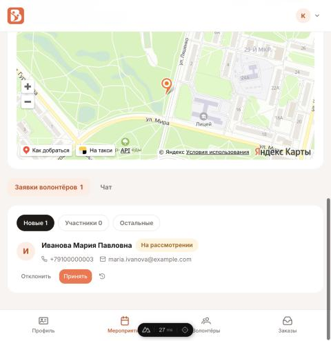 |
| 2 | «Принять» | Тост «Заявка принята», «Участвуют 1 из 12», «Новые 0 / Участники 1» |
| 3 | Субботник → «Отклонить» у Петрова Д. | Окно «Отклонение заявки», поле «Причина (видит только волонтёр)» |
| 4 | Ввёл «Набор уже закрыт, ждём вас на следующем субботнике» → «Отклонить» | Тост «Заявка отклонена»; в «Остальные» — Петров Д., «Отклонена», причина видна 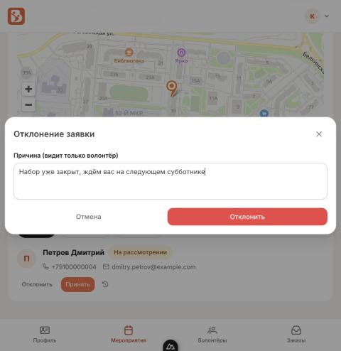 |

**Вердикт:** ✅
⚠️ **ЗАМЕЧАНИЕ-7**: в окне отклонения не сказано, что отказ окончательный (по proto повторная заявка на это мероприятие невозможна) — координатор может отклонить, не понимая последствий.

## T13 — Чат мероприятия (сторона координатора) ✅ (1 замечание)

| Шаг | Действие | Что увидел |
|---|---|---|
| 1 | Экоакция → вкладка «Чат» (`?tab=chat`) | Лента «Напишите первое сообщение участникам», поле «Сообщение» |
| 2 | Ввёл «Всем привет! Сбор 27 октября в 10:45 у ДК ФЭИ, возьмите перчатки.» → Enter | Поле очистилось; в ленте **одно** сообщение (без дубля от стрима) с чипом «Координатор» и временем 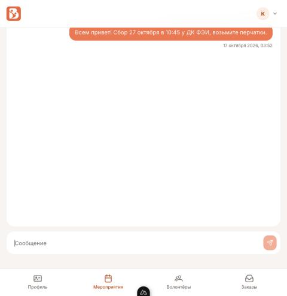 |

**Вердикт:** ✅ (получение сообщения волонтёром — в T20)
⚠️ **ЗАМЕЧАНИЕ-8**: сообщения прижаты к верху ленты, ниже большая пустая область; в мессенджерах привычнее прижимать к низу.

## T14 — Подведение итогов ✅

Мероприятие «Помощь приюту» (16.10, прошло), приняты Мария и Дмитрий.

| Шаг | Действие | Что увидел |
|---|---|---|
| 1 | Открыл «Подвести итоги» | У каждого «Был / Не был», «3 ч \| 00 мин», +30; сводка 2 / 0 / 6 ч / 60 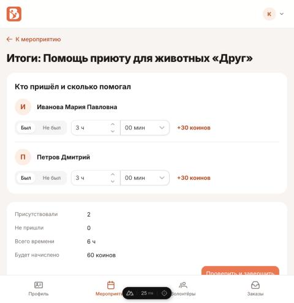 |
| 2 | Марии стёр часы (0 ч 00 мин) → «Проверить и завершить» | Тост-ошибка «Укажите отработанное время для каждого присутствовавшего», подтверждение не открылось 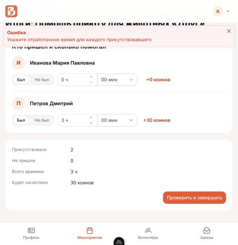 |
| 3 | Марии ввёл «4», Дмитрию «Не был» | Мария +40; у Дмитрия поля заблокированы, «—»; сводка 1 / 1 / 4 ч / 40 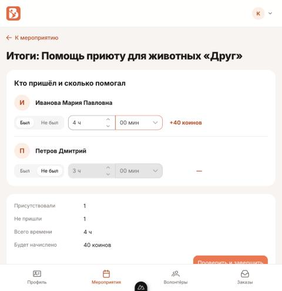 |
| 4 | Марии выбрал «30 мин» | +45; сводка «4 ч 30 мин · 45 коинов» — верно (9 × 5) |
| 5 | «Проверить и завершить» | «Итоговая проверка: Присутствовали 1, не пришли 1. Будет начислено 4 ч 30 мин и 45 коинов. Изменить итоги после подтверждения нельзя.» 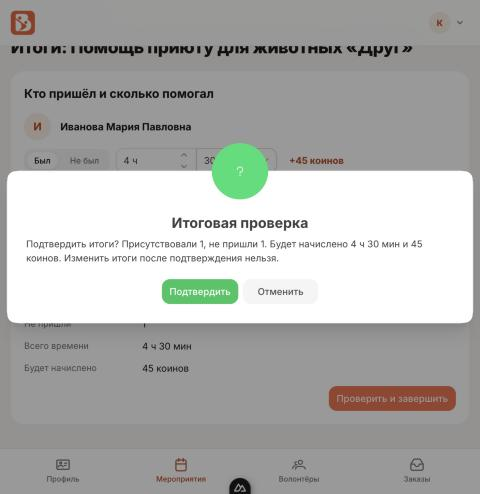 |
| 6 | «Подтвердить» | Тост «Итоги подведены, коины начислены»; «Итоги зафиксированы…», Мария «4 ч 30 мин · +45 коинов», Дмитрий «Не пришёл» 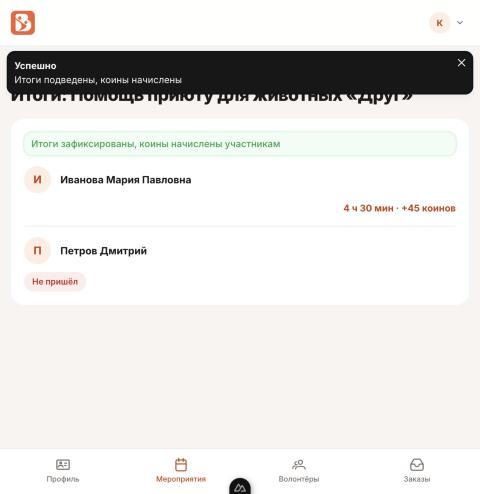 |

**Вердикт:** ✅ расчёт, валидация и фиксация итогов работают. Начисление у Марии проверю в T20.

## T15 — Заказы поощрений: выдача ❌ → исправлено (1 замечание)

| Шаг | Действие | Что увидел |
|---|---|---|
| 1 | «Заказы», фильтр «Ожидает выдачи» | Значок «Волонтёр Обнинска» — Иванова М. П. (ссылка на профиль), 20 коинов, «Отменить / Выдано» 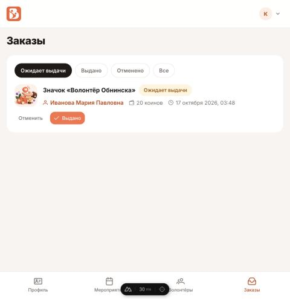 |
| 2 | «Выдано» | Тост «Поощрение выдано» (без подтверждения) |
| 3 | Проверка списка сразу после | **Под фильтром «Ожидает выдачи» остался 1 заказ** — уже со статусом «Выдано» |
| 4 | Переключил «Выдано» → «Ожидает выдачи» | Только после перезагрузки списка — «Заказов нет»; в «Выдано» два заказа |
| 5 | Причина | `replace()` в сторе меняет заказ в списке, не проверяя текущий фильтр по статусу. Тот же шаблон в сторе заявок: у волонтёра с фильтром «На рассмотрении» отменённая заявка оставалась бы в списке |
| 6 | Исправление | Оба стора (`reward-orders`, `participations`) убирают из списка элемент, который перестал подходить под фильтр по статусу, и уменьшают `total` |

**Вердикт:** ❌ **БАГ-3** (выданный/отменённый заказ остаётся в «Ожидает выдачи»; аналогично для заявок) — исправлен, перепроверка в T20.
⚠️ **ЗАМЕЧАНИЕ-9**: «Выдано» — необратимое действие, но выполняется без подтверждения (отмена заказа, наоборот, подтверждается).

## T16 — Создание мероприятия: валидация и успех ✅ (1 замечание)

| Шаг | Действие | Что увидел |
|---|---|---|
| 1 | «Мои мероприятия» → «Создать мероприятие» | Диалог «Новое мероприятие»: Название, Описание, Место проведения + Яндекс-карта 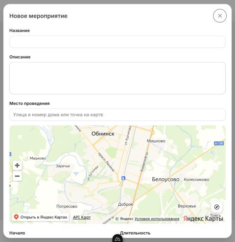 |
| 2 | «Опубликовать» с пустой формой | Тост «Укажите название» |
| 3 | Ввёл «Тест: уборка двора» → «Опубликовать» | Тост «Отметьте место проведения на карте» |
| 4 | Внизу формы | По умолчанию **«Начало» = 18.10.2026 04:00** 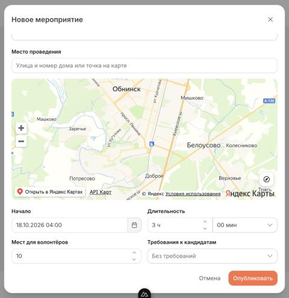 |
| 5 | Клик по карте | Адрес подставился сам: «проспект Ленина, 53», координаты 55.09175, 36.61220 |
| 6 | Стёр часы (0 ч 00 мин) → «Опубликовать» | Тост «Укажите длительность» |
| 7 | Ввёл «2» → «Опубликовать» | Тост «Мероприятие опубликовано», переход на страницу мероприятия: «18 октября 2026, 04:00–06:00», 2 ч, «проспект Ленина, 53», «Опубликовано» 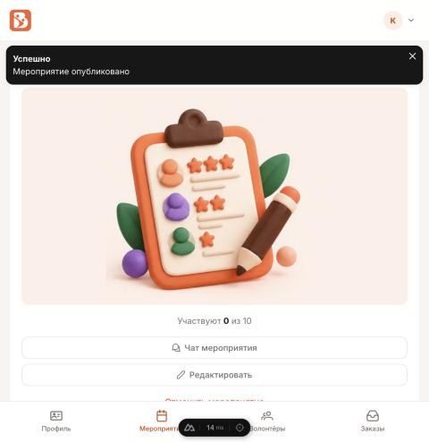 |

**Вердикт:** ✅ все проверки формы срабатывают по порядку, создание работает.
⚠️ **ЗАМЕЧАНИЕ-10**: начало по умолчанию = «сейчас + 24 часа», округлённое до получаса; ночью это даёт 04:00. Лучше ставить завтра на 10:00.

## T17 — Профиль волонтёра глазами координатора ✅ (1 замечание)

| Шаг | Действие | Что увидел |
|---|---|---|
| 1 | «Волонтёры» → фильтр «Сотрудничество 2» | Петров Д. и Иванова М. П. — имена-ссылки на профиль |
| 2 | Профиль Ивановой | «Сотрудничество», почта и телефон видны; **2 мероприятия · 8 часов · 85 коинов** (40 + 45); «Исключить из команды»; вкладки «Участия 4 · Отказы · Заказы 2» 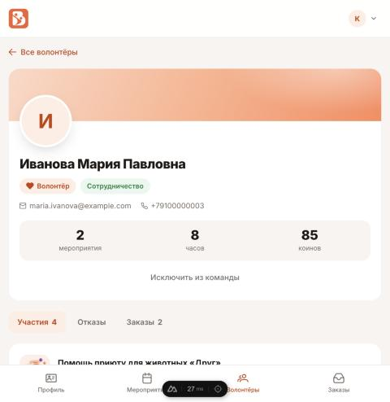 |
| 3 | «Участия» | Приют (+45 за 4 ч 30 мин, подтверждено), Экоакция (Принята), Субботник (Принята), Высадка деревьев (+40 за 4 ч, подтверждено) |
| 4 | Профиль Петрова → «Отказы 1» | Субботник, «Отказ 17 октября 2026, 03:52», причина «Набор уже закрыт, ждём вас на следующем субботнике», «Отклонена» |

**Вердикт:** ✅ данные из T12 и T14 отражаются у координатора.
⚠️ **ЗАМЕЧАНИЕ-11**: в счётчике «8 часов» отброшены минуты (на самом деле 8 ч 30 мин). То же в профиле волонтёра.

## T18 — Приглашение в команду (часть 1: координатор) ✅

| Шаг | Действие | Что увидел |
|---|---|---|
| 1 | «Волонтёры» → блок «Пригласить в команду» → «Создать ссылку» (срок: бессрочно) | Тост «Приглашение создано», новая ссылка `…/invite/S2kJb7…` «Бессрочное» над сидовой 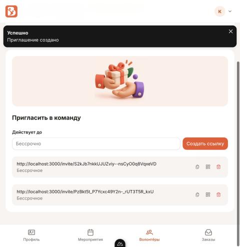 |
| 2 | Иконка QR у ссылки | Окно «QR-код приглашения», QR 240×240, «Скопировать ссылку» 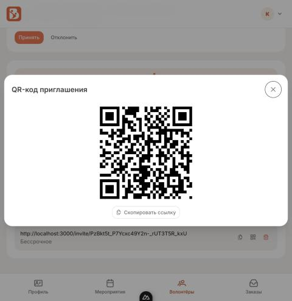 |

Часть 2 (принятие волонтёром) — в T22.

## T19 — Загрузка фото ❌ → исправлено ✅ (1 замечание)

| Шаг | Действие | Что увидел |
|---|---|---|
| 1 | «О вас» → выбрал `anim.gif` | `accept="image/jpeg,image/png"`; тост «Поддерживаются изображения JPEG и PNG», кадрирование не открылось |
| 2 | Выбрал PNG на 21 МиБ | Тост «Выберите изображение размером до 20 МиБ» 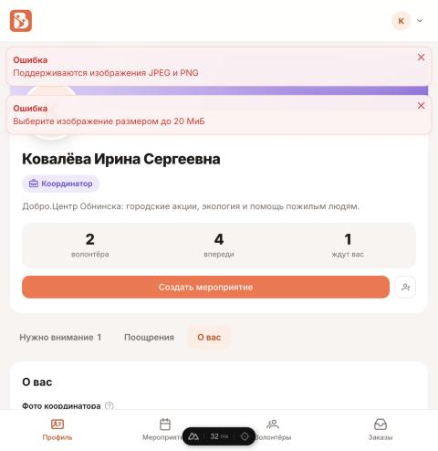 |
| 3 | Выбрал «битый» `broken.png` (тип PNG, внутри мусор) | **Открылось пустое окно «Выбор миниатюры»**, «Сохранить» неактивна, никаких объяснений 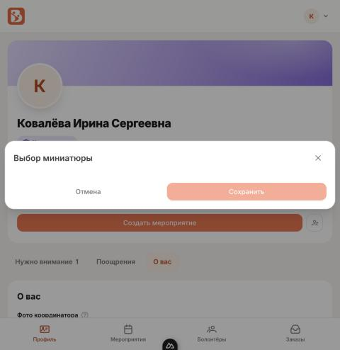 |
| 4 | Исправление | Окно кадрирования обрабатывает ошибку загрузки картинки: закрывается и показывает тост |
| 5 | Повтор с `broken.png` | Тост «Не удалось прочитать изображение, выберите другой файл», окно не висит |
| 6 | Нормальный PNG 900×600 | Кадрирование: квадратная рамка с кругом по центру 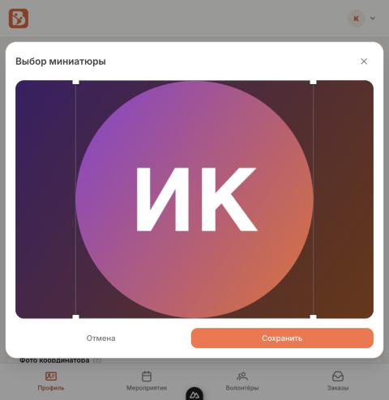 |
| 7 | «Сохранить» | Тост «Фото обновлено», аватар в профиле — 200×200 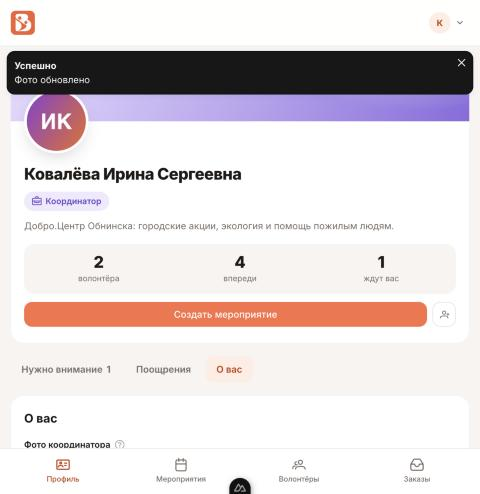 |

**Вердикт:** ❌ **БАГ-4** (битый файл → пустое зависшее окно кадрирования) — **исправлен и перепроверен** ✅.
⚠️ **ЗАМЕЧАНИЕ-12**: в режиме координатора в шапке показывается фото профиля волонтёра (буква «К»), а не только что загруженное фото координатора. По контракту аватары независимы — стоит решить, какое показывать в шапке в каждом режиме.

## T20 — Сквозная проверка: результаты у волонтёра ❌ → исправлено ✅ (1 замечание)

| Шаг | Действие | Что увидел |
|---|---|---|
| 1 | Выход из Ирины → вход Марией | Счётчики **45 коинов · 8 часов · 2 мероприятия** (0 + 45 за приют); «Помощь приюту» — «+45 коинов за 4 ч 30 мин, Участие подтверждено»; Экоакция — «Принята»  |
| 2 | Экоакция (волонтёр) | «Участвуют 1 из 12», «Принята», появились вкладки «О мероприятии / Чат» и кнопка «Чат мероприятия» |
| 3 | Вкладка «Чат» | Сообщение Ирины с чипом «Координатор»; ответ «Приняла, буду с перчатками!» → справа как своё 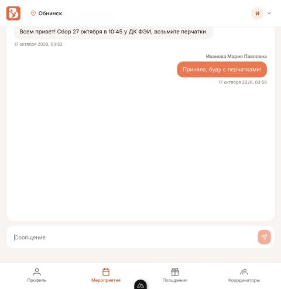 |
| 4 | Перепроверка БАГ-3 (заявки): фильтр «Принята» → «Отменить» Субботник → подтвердить | Субботник сразу исчез из «Принята» ✅ |
| 5 | Боковая колонка в тот же момент | **«Ближайшие дела» всё ещё показывает отменённый Субботник** 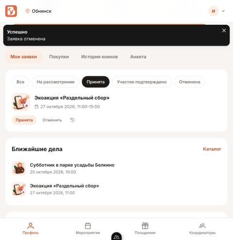 |
| 6 | Причина | Колонка загружалась один раз при открытии страницы |
| 7 | Исправление | Колонка перезагружается при изменении статусов заявок в сторе |
| 8 | Повтор: обновил страницу (остался только Экоакция) → отменил Экоакцию под фильтром «Принята» | Список «Принята» пуст, колонка сразу: «Когда координатор примет заявку…» ✅ 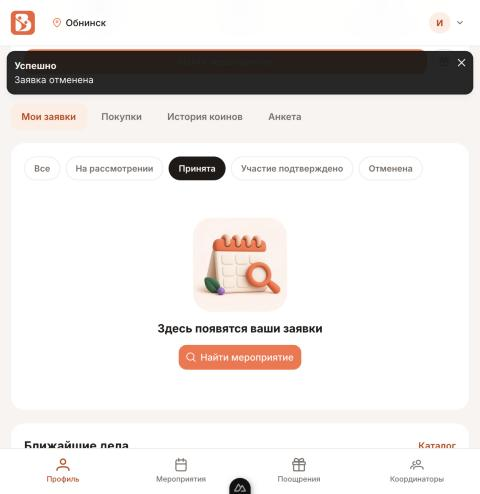 |
| 9 | Перепроверка БАГ-3 (заказы): Мария обменяла значок (45 → 25), Ирина под фильтром «Ожидает выдачи» нажала «Выдано» | Тост «Поощрение выдано», список сразу «Заказов нет» ✅ 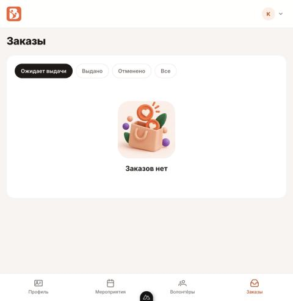 |

**Вердикт:** ❌ **БАГ-5** (после отмены заявки боковая колонка «Ближайшие» показывает её до перезагрузки) — **исправлен и перепроверен** ✅. Исправление БАГ-3 подтверждено и для заявок, и для заказов. Сообщение Дмитрию об отказе Марии не видно ✅.
⚠️ **ЗАМЕЧАНИЕ-13**: при активном фильтре пустой список подписан «Здесь появятся ваши заявки» с кнопкой «Найти мероприятие», хотя заявки есть, просто с другим статусом.

## T22 — Приглашение в команду (часть 2: волонтёр) ✅ (1 замечание)

| Шаг | Действие | Что увидел |
|---|---|---|
| 1 | Мария → «Координаторы» → «Покинуть команду» у Ковалёвой | Подтверждение «Прекратить сотрудничество с координатором Ковалёва Ирина Сергеевна? Активные заявки и невыданные заказы будут отменены.» |
| 2 | «Прекратить» | Тост «Сотрудничество прекращено», статус «Сотрудничество прекращено», кнопка «Вступить в команду»; у Ковалёвой видно новое фото из T19 |
| 3 | Открыл ссылку из T18 `/invite/S2kJb7…` | «Приглашение к сотрудничеству — Координатор приглашает вас в свою команду», «Принять приглашение» 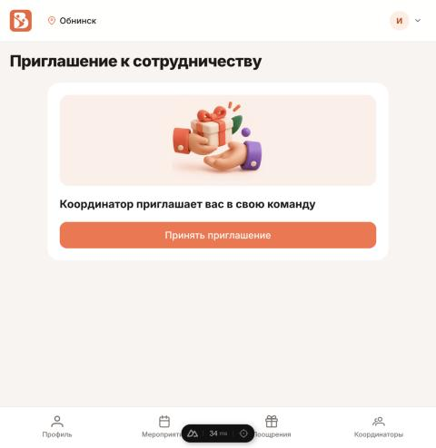 |
| 4 | «Принять приглашение» | Тост «Сотрудничество установлено»; карточка Ковалёвой с фото и описанием, «Мероприятия / Поощрения» 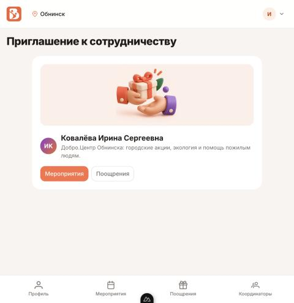 |
| 5 | «Координаторы» | Ковалёва снова «Сотрудничество», «Профиль / Покинуть команду» |

**Вердикт:** ✅ выход из команды и вступление по ссылке работают.
⚠️ **ЗАМЕЧАНИЕ-14**: до принятия не видно, какой координатор приглашает. Это ограничение proto: есть только `AcceptCooperationInvitation`, метода просмотра приглашения нет. Нужен RPC на бэкенде, если это важно.

## T21 — Мобильная вёрстка (375×812) ✅ (1 замечание)

Проверка: `document.documentElement.scrollWidth` должен быть равен 375 (нет горизонтальной прокрутки).

| Страница | scrollWidth | Что увидел |
|---|---|---|
| `/` | 375 | Шапка: логотип, «Обнинск», «Личный кабинет», бургер; hero и кнопки на всю ширину 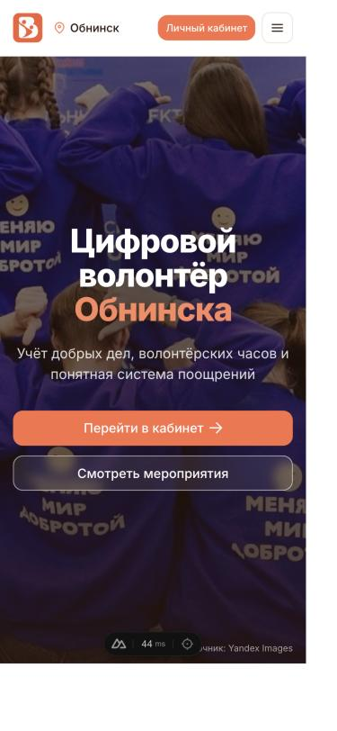 |
| `/cabinet` | 375 | Профиль: аватар, ФИО в 2 строки, чипы, счётчики 25 · 8 · 2, нижняя навигация 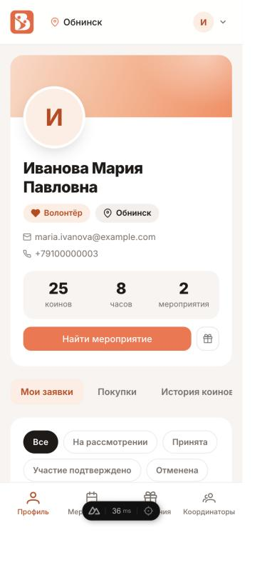 |
| `/cabinet/events` | 375 | Карточки в одну колонку |
| `/cabinet/events/{id}` | 375 | Иллюстрация, «Участвуют 0 из 12», «Отменена», «Подать заявку снова» 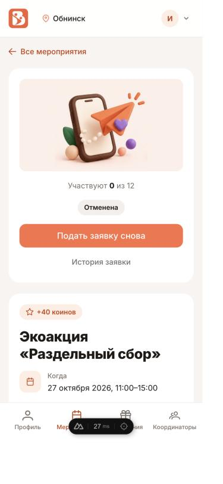 |
| `/cabinet/rewards` | 375 | — |
| `/cabinet/coordinators/{id}` | 375 | — |
| `/cabinet?tab=wallet` | 375 | Вкладки прокручиваются по горизонтали, «Анкета» за краем 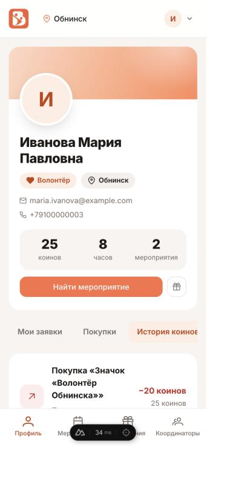 |

Кабинет координатора на мобильном проверялся в прошлых итерациях, лендинг — в T01 (там БАГ-1).

**Вердикт:** ✅ горизонтального переполнения нет.
⚠️ **ЗАМЕЧАНИЕ-15**: ряд вкладок прокручивается вбок без визуальной подсказки (нет затухания у края) — «Анкета» легко не заметить.

## Перепроверка БАГ-1 после исправления ✅

| Шаг | Действие | Что увидел |
|---|---|---|
| 1 | 375 px, лендинг → бургер | Меню (289 px) выпадает поверх, высота шапки не меняется (69 px) |
| 2 | «Мероприятия» | Меню закрылось, `#events` встал на **84 px** — сразу под шапкой, как на десктопе 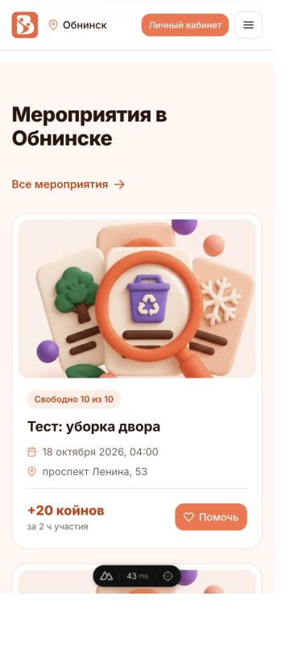 |

Финальные проверки кода: `vue-tsc` — 0 ошибок; `eslint` — только старая `PALLETS` в `theme.settings.js`.
